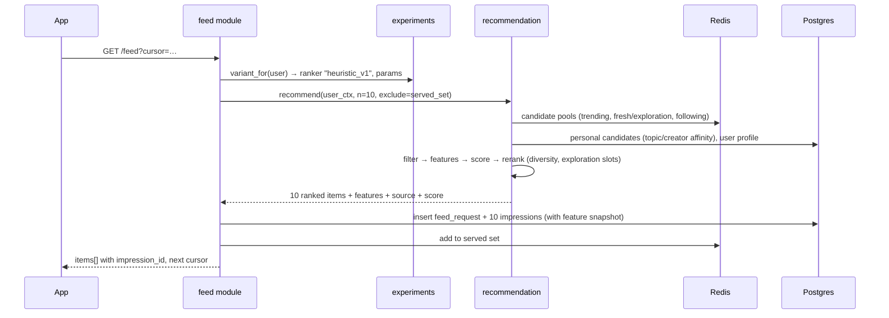

# 01 — Technical Architecture

> Status: **APPROVED** — decisions in [07-decisions.md](07-decisions.md) approved 2026-10-26.
> Items marked **(D#)** depend on a decision listed there.

## 1. Goals and non-goals

**Product goal:** a vertical short-video app whose differentiator is a feed that
learns quickly from each user's behaviour.

**Architectural goals, in priority order**

1. **Every recommendation is measurable.** Every video shown is logged with the
   request it came from, its position, the ranker version, and the features the
   ranker saw. Without this, neither the dashboard nor a future ML model is possible.
2. **The ranker can be swapped without touching the app.** The heuristic ranker
   (MVP) and future ML rankers implement the same interface and are selected per
   user by the experiment framework.
3. **Simple to run while small.** One API process, one Postgres, one Redis, one
   object store. No Kafka, no feature store, no model server until the data
   justifies them.
4. **Clean seams for scaling.** Each component that will need to scale on its own
   (event ingestion, recommendation, video processing) sits behind a module
   boundary, so it can be split out later without a rewrite.

**Non-goals for the MVP:** comments, DMs, live streaming, music/sound library,
in-app video editing, monetisation, and multi-region deployment.

## 2. System overview

```mermaid
flowchart LR
  subgraph Client["Mobile app (Expo / React Native) (D1)"]
    Feed[Vertical feed + player]
    Upload[Capture / upload]
    Tracker[Event tracker<br/>offline queue + batching]
  end

  subgraph API["API — modular monolith (FastAPI) (D2)"]
    Auth[auth]
    Videos[videos]
    Social[social<br/>likes · follows · shares]
    FeedSvc[feed]
    Reco[recommendation<br/>candidates → filter → rank → rerank]
    Exp[experiments]
    Ingest[events ingestion]
    Analytics[analytics API]
  end

  subgraph Workers["Background workers"]
    Agg[interaction aggregator]
    Stats[video stats / trending]
    Aff[user affinity updater]
    Rollup[analytics rollups]
  end

  PG[(PostgreSQL 18)]
  Redis[(Redis)]
  Store[(Object storage + CDN)]
  Transcode[Video processing<br/>managed or FFmpeg (D3)]
  Dash[Analytics dashboard (web) (D6)]

  Feed -->|GET /feed| FeedSvc --> Reco
  Reco --> Exp
  Reco --> Redis
  Reco --> PG
  Tracker -->|POST /events/batch| Ingest --> PG
  Upload -->|1. create video| Videos
  Upload -->|2. direct upload| Transcode
  Transcode -->|3. webhook: ready| Videos
  Transcode --> Store
  Feed -->|HLS playback| Store
  Ingest -. enqueue .-> Workers
  Workers --> PG
  Workers --> Redis
  Dash --> Analytics --> PG
```

## 3. Components

### 3.1 Mobile app (D1: Expo / React Native, TypeScript)

| Concern | Approach |
|---|---|
| Vertical feed | Full-screen `FlatList`/`FlashList` with `pagingEnabled`, one item per screen height. |
| Playback | `expo-video` with HLS. Only the visible item and its neighbours (±1) mount a player, so memory stays flat no matter how far the user scrolls. The next 2 videos are preloaded. |
| Infinite scroll | Cursor-paginated `GET /feed`. The app fetches the next page when 3 items remain. |
| Upload | Pick or record a video → `POST /videos` returns a direct-upload URL → upload straight to storage (bytes never pass through our API) → poll or receive a push when processing finishes. |
| Event tracking | One `Tracker` module. It records view sessions (start, watch time, loops, exit reason) and social actions, persists them to an on-device queue, and flushes in batches every 10 s, when 20 events are queued, and when the app goes to the background. Every event carries a client-generated UUID, so retries never double-count. |
| API client | Generated from the backend's OpenAPI spec, so types never drift. |

### 3.2 API — modular monolith (D2: Python + FastAPI)

The API is a single deployable split into modules with explicit boundaries.
Modules talk to each other only through service interfaces, never through each
other's tables. That rule is what lets us split `recommendation` or `events`
into separate services later.

| Module | Responsibility |
|---|---|
| `auth` | Sign-up, login, JWT access tokens (15 min) and rotating refresh tokens (30 days). (D4) |
| `users` | Profiles and onboarding interests. |
| `videos` | Upload sessions, processing webhooks, metadata, topics and hashtags, status lifecycle. |
| `social` | Likes, follows, shares. Writes the canonical state and also emits events. |
| `feed` | HTTP layer for `GET /feed`. Handles pagination, de-duplicates against what was already served, and calls `recommendation`. |
| `recommendation` | The ranking pipeline (see [02-recommendation-engine.md](02-recommendation-engine.md)). Pure domain logic plus repository interfaces, with no HTTP code. |
| `experiments` | Deterministic user → variant assignment, which picks the ranker version and its parameters. |
| `events` | Batch ingestion, validation, de-duplication, and enqueueing for aggregation. |
| `analytics` | Read-only metric queries that back the dashboard. |

### 3.3 Background workers

These use the same codebase as the API, run as a separate process, and use a
Redis-backed job queue (`arq`) plus a scheduler.

| Job | Trigger | Output |
|---|---|---|
| Interaction aggregator | Each ingested batch | Upserts one `interactions` row per impression: the per-impression label (watch ratio, completed, skipped, replays, liked, …). |
| Affinity updater | Each finished interaction | Applies decayed updates to `user_affinities` (topics, hashtags, creators). |
| Video stats | Every 5 min | Refreshes `video_stats` (smoothed engagement rates) and the trending set in Redis. |
| Cold-start pool manager | Every 5 min | Promotes or demotes new videos between exploration traffic tiers. |
| Analytics rollups | Hourly or daily | `daily_user_activity`, retention cohorts, recommendation quality by ranker version. |

### 3.4 Data stores

| Store | Holds | Why |
|---|---|---|
| **PostgreSQL 18** | Everything durable: users, videos, social graph, impressions, events, interactions, affinities, stats, experiments. | One system to operate. Native `uuidv7()` gives time-ordered IDs. Month-partitioned event and impression tables keep them manageable. `pgvector` becomes available for embeddings later. |
| **Redis** | Feed session state (videos already served), trending and candidate pools, rate limits, the job queue, hot counters. | Feed requests must be fast. Everything in Redis can be rebuilt from Postgres. |
| **Object storage + CDN** | Original uploads, HLS renditions, thumbnails. | Video bytes never touch the API. (D3) |

### 3.5 Video pipeline (D3)

```
client ──POST /videos──▶ API (video.status = 'uploading', returns upload URL)
client ──PUT bytes─────▶ storage / transcoder
transcoder ─webhook────▶ API (status = 'processing' → 'ready' | 'failed';
                              duration, dimensions, playback_url, thumbnail)
API ──────────────────▶ the 'ready' video enters the cold-start exploration pool
```

## 4. Feed request flow (hot path)



**Latency budget:** p95 ≤ 150 ms server-side for `GET /feed`. Candidate
generation ≤ 40 ms, scoring of about 500 candidates ≤ 30 ms, impression logging
≤ 20 ms (batched insert). The app prefetches, so the user never waits on this call.

## 5. Cross-cutting concerns

* **Identifiers:** UUIDv7 everywhere. They are time-sortable, which helps
  pagination and partitioning.
* **API style:** REST + JSON, with OpenAPI generated from the code and versioned
  under `/v1`.
* **Security:** Argon2id password hashes. Short-lived JWTs. Refresh-token
  rotation with reuse detection. Signed upload URLs scoped to one object. Rate
  limits on auth, upload, and events. All content endpoints check video status
  and visibility.
* **Privacy:** Behavioural tracking is the core of the product, so the privacy
  policy must disclose it, users must be able to export and delete their data,
  and the design avoids collecting device identifiers beyond what is needed. (D9)
* **Observability:** Structured JSON logs carrying `request_id`. OpenTelemetry
  traces. Prometheus-style metrics for feed latency, candidate counts per source,
  ingestion lag, and job failures.
* **Testing:** Unit tests for ranking components with fixed fixtures.
  Integration tests against a real Postgres (testcontainers). A deterministic
  "replay" harness that runs any ranker over logged requests.

## 6. Scaling path (not built now)

| Pressure | Step |
|---|---|
| Event volume > ~50M rows/month | Move events to Redpanda/Kafka → ClickHouse (or BigQuery). Postgres keeps interactions and affinities only. |
| Feed QPS or CPU from ranking | Extract `recommendation` into its own service. The interface is already a function call with typed DTOs. |
| ML ranker | A separate inference service (ONNX/LightGBM, later Triton) behind the same `Ranker` interface. |
| Embedding retrieval | `pgvector` HNSW first, then a dedicated vector DB if needed. |
| Global audience | CDN is already global. Add read replicas, then regional API deployments. |
