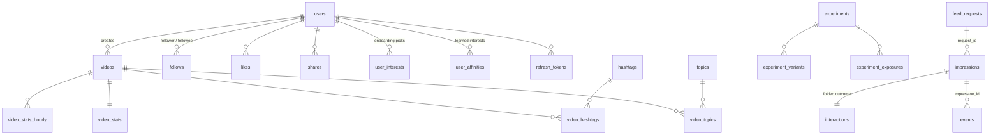

# 04 — Database Schema

> Source of truth: [`db/migrations/0001_init.sql`](../db/migrations/0001_init.sql)
> (PostgreSQL 18). The DDL has been checked to apply cleanly. PG16 was used for
> the check, with a shim for `uuidv7()`, which is native in PG18.

## Entity overview

## The four layers

| Layer | Tables | Write pattern | Purpose |
|---|---|---|---|
| **Canonical state** | `users`, `videos`, `topics`, `hashtags`, `follows`, `likes`, `shares`, `blocks`, `user_interests`, `experiments*` | OLTP, small rows | The truth about the product |
| **Serving logs** | `feed_requests`, `impressions` | Append-only, partitioned monthly | *What we showed and why*: ranker version, features, predictions, propensity |
| **Behaviour logs** | `events` → `interactions` | Append-only / upsert, partitioned monthly | *What the user did*, as raw events plus one folded label row per impression |
| **Derived state** | `user_affinities`, `video_stats`, `video_stats_hourly`, `app_sessions`, `daily_user_activity` | Recomputed by workers | Fast inputs for ranking and analytics; rebuildable from the logs |

`impressions ⋈ interactions` on `impression_id` **is the ML training set**.
Every row has the features as the ranker saw them, the ranker's predictions,
and the outcome that followed.

## Notable choices

* **UUIDv7 primary keys.** They are time-ordered, so B-tree inserts stay local
  and IDs sort by creation time. `uuid_extract_timestamp(impression_id)` gives
  the partition key for lookups by ID alone.
* **Partitioned logs, with no foreign keys on them.** Inserts stay cheap, old
  months can be dropped or archived per partition, and user deletion runs as a
  purge job instead of a cascade across hundreds of millions of rows.
* **`topics` vs `hashtags`.** Topics are a curated taxonomy of about 20–40
  entries. They power onboarding, cold start, and diversity rules. Hashtags are
  free-form, from creators. Both feed into affinities.
* **One generic `user_affinities` table** keyed by `(entity_type, entity_id)`,
  so new interest dimensions (sounds, languages, embedding clusters) need no
  schema change.
* **Lazy decay.** Affinity rows store `score` and `updated_at`, and decay is
  applied on read and write. No nightly job has to rewrite every row.
* **`interactions` has a `value_model_version`.** If the definition of "good"
  changes, labels can be recomputed from `events` and the old ones still make
  sense.
* **Experiments are assigned by hashing, not stored per request.**
  `experiment_exposures` records only the first exposure, so retention can be
  analysed by variant.

## Planned later migrations

| Migration | Phase | Content |
|---|---|---|
| `0002_seed_topics` | 1 | Initial topic taxonomy |
| `0003_analytics_views` | 4 | Retention cohort and recommendation-quality views |
| `0004_moderation` | before public launch | `reports`, moderation queue, audit log |
| `0005_embeddings` | ML v3 | `pgvector` columns for video and user embeddings, plus HNSW indexes |
| `0006_comments` | post-MVP | Comments |
